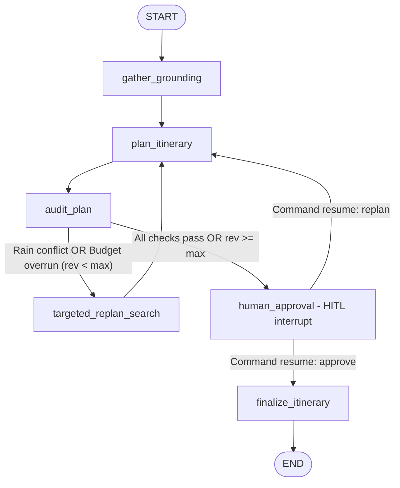

# 🧭 TripPilot — Self-Correcting Weather & Budget Travel Agent

**TripPilot** is a stateful **LangGraph** agent that plans multi-day travel itineraries using **live Open-Meteo weather forecasts** (no API key required), **DuckDuckGo web search**, and a **deterministic Python budget & weather verifier**.

Unlike single-shot prompt chatbots, TripPilot enforces hard constraints through **cyclic self-correction** and pauses mid-run for **Human-in-the-Loop (HITL)** approval via SQLite-persisted LangGraph checkpoints (`interrupt` + `Command(resume=...)`).

---

## Why It Stands Out

- **Deterministic Guardrails (Zero LLM Math):** A pure Python budget calculator (`src/trippilot/tools/budget.py`) and weather conflict auditor (`src/trippilot/tools/weather.py`) verify every draft.
- **Self-Correcting Conditional Loop:** If an outdoor activity lands on a rainy day or estimated costs exceed the budget ceiling, `route_after_audit` automatically loops back to fetch indoor/budget alternatives on DuckDuckGo and re-plans—capped by `max_revisions` to prevent infinite cycles.
- **True LangGraph HITL (`interrupt` / `Command`):** Execution pauses cleanly inside `human_approval`, persisted in SQLite (`SqliteSaver`), allowing the traveler to approve, request revisions, or adjust the budget before finalizing.
- **Dual-Audience Streamlit UI:** Clean trip cards, 1-click demo presets, and Markdown export for non-technical viewers—plus a **Before/After Self-Correction Diff**, **Execution Trace Timeline**, and **Mermaid Graph** for engineering reviewers.
- **₹0 Stack:** Python, LangGraph, Gemini / Groq free tiers (plus a zero-key Demo Mode), Open-Meteo, DuckDuckGo (`ddgs`), and Streamlit.

---

## Architecture



---

## Quickstart

```bash
# 1. Create and activate a virtual environment (Python >= 3.11)
python -m venv .venv
.venv\Scripts\activate  # Windows
# source .venv/bin/activate  # macOS/Linux

# 2. Install TripPilot and dev dependencies
pip install -e ".[dev]"

# 3. Optional: add free Gemini or Groq key (or run Demo Mode with no key)
copy .env.example .env

# 4. Launch the Streamlit app
python -m streamlit run app.py
```

---

## Running Tests (100% Offline)

All unit and LangGraph integration tests mock external HTTP/LLM calls and require zero API keys:

```bash
pytest
```

---

## Project Structure

- `app.py` — Streamlit frontend (1-click presets, HITL approval card, diff & trace tabs, exports)
- `src/trippilot/config.py` — Environment/Streamlit secrets resolution and Gemini/Groq model factory
- `src/trippilot/state.py` — Typed Pydantic schemas and `TripState`
- `src/trippilot/tools/weather.py` — Open-Meteo geocoding, 16-day forecast, >16-day archive proxy, WMO decoding, and rain conflict auditor
- `src/trippilot/tools/search.py` — DuckDuckGo (`ddgs`) web search and targeted replan queries
- `src/trippilot/tools/budget.py` — Deterministic Python budget calculator
- `src/trippilot/graph/` — LangGraph nodes, conditional routing, and SQLite-backed workflow
- `tests/` — Unit and end-to-end LangGraph HITL + self-correction tests

